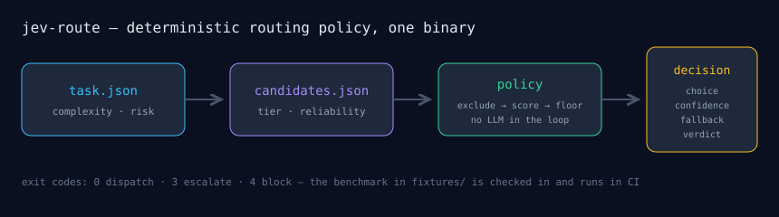

# jev-route

A routing policy as a single Rust binary: a task and a candidate list go in, a
choice, a confidence and a fallback verdict come out. No LLM in the loop —
this is the deterministic half of agent routing, the part that should be code.




## Verify in 60 seconds

```bash
git clone https://github.com/mrodgersjs-web/jev-route.git
cd jev-route
cargo test --release                       # 11 tests (the repo's npm test)
cargo run --release -- validate \
  --fixture fixtures/benchmark.json        # 7/7 cases, exit 0
```

Exit codes are the contract: `0` dispatch, `3` escalate, `4` block.

## What it does

`jev-route route --task task.json --candidates candidates.json [--policy policy.json] [--json]`

1. **Hard exclusions.** A task can demand image capability, outward approval,
   or an allowed tier list. Disqualified candidates score zero, with the reason
   recorded.
2. **Scoring.** Each surviving candidate is scored on capability match against
   task complexity, cost waste (penalised harder when risk is low), reliability,
   and band fit — a bonus for right-sizing, not for maxing out.
3. **Confidence floor.** The best candidate only dispatches at or above the
   floor (`0.55` by default). Below it the decision is `ESCALATE` and names the
   runner-up as fallback. With no eligible candidate at all it is `BLOCK`.

Every decision carries its per-candidate scores and reasons, so the routing is
auditable after the fact, not just reproducible.

## The benchmark is checked in

`fixtures/benchmark.json` holds seven policy cases with expected verdicts and
choices: right-sizing beats muscle, outward work gates on approval, a blind
tier cannot take image tasks, a lone weak candidate escalates, ties break by
name so runs are deterministic. `jev-route validate` runs them; CI runs it on
every push. Changing the policy without changing the benchmark's mind is how
this catches itself.

## Why

This fleet routes work between model tiers hundreds of times a day. The policy
that governs those choices lived inside orchestration code. It is now a
standalone, testable artifact with a public benchmark — the compiled-language
counterpart to the Python harnesses and the TypeScript surfaces elsewhere on
this profile.

## Limits, stated plainly

- One-shot scoring, not a serving layer. It chooses; it does not dispatch.
- Tier capability and cost are policy constants, calibrated for this fleet,
  not universal measurements.
- Reliability is an input, not a claim: pass in what you have measured.

Part of the [mrodgersjs-web](https://github.com/mrodgersjs-web) FDE studio fleet — control planes, gates, fleets, proof. [rodgersintelligence.com](https://rodgersintelligence.com)
